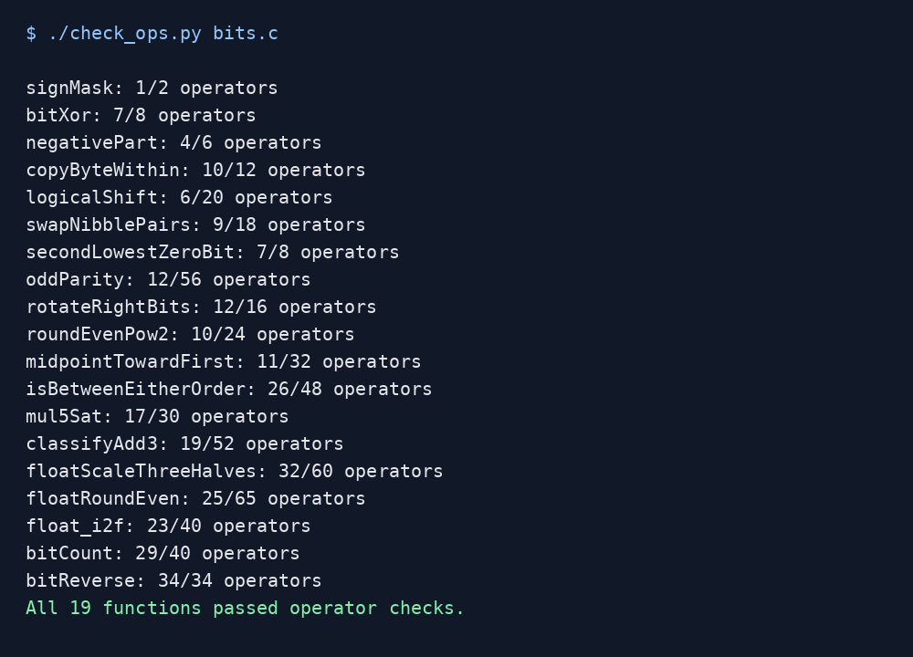
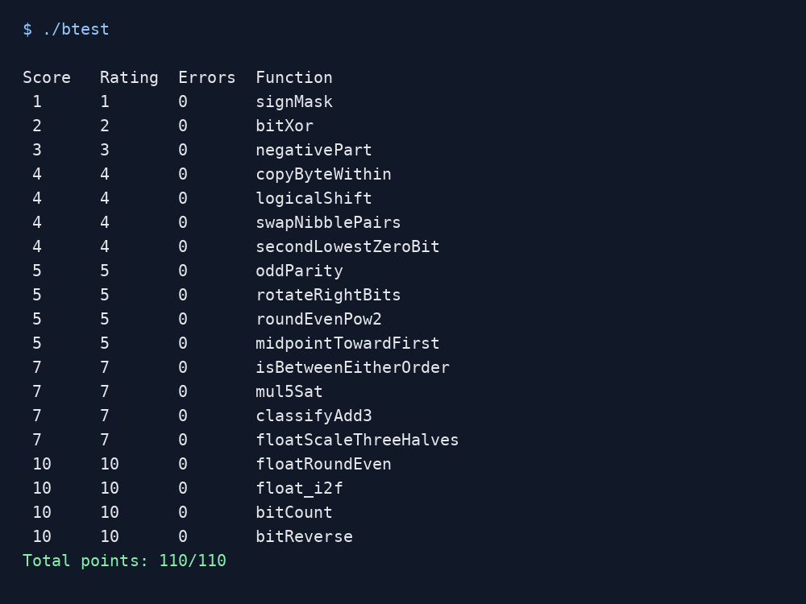

# Lab1：Data Lab 实验报告

- 姓名：闫鹏飞
- 学号：25803050097
- 日期：2026 年 10 月 9 日

## 实验目标与环境

在规定的运算符和操作数限制内，实现 `bits.c` 中的 19 个函数，练习补码、掩码、移位、溢出判断和 IEEE 754 单精度浮点编码。

本地环境为 x86-64 Linux，使用 GCC 编译。整数题按实验规定的 32 位补码和位向量模型解释，右移为算术右移。系统最初缺少 32 位开发库，因此从 Ubuntu 软件源下载所需依赖并解压到临时目录，使用额外的头文件、链接器和库路径完成 `-m32 -fwrapv` 构建，未修改 `Makefile` 或 `.github`。另外也按仓库 GitHub Actions 中的配置，使用 `-O -Wall -fwrapv` 完成了 64 位构建测试，两种构建均得到 110/110。

## 测试结果

对最终代码执行了以下两条命令：

```bash
./check_ops.py bits.c
./btest
```

下方图片根据本次实际终端输出日志渲染生成，完整文字日志也保存在 `images/` 中，便于核对。

### 运算符检查



[查看完整检查日志](images/operator-check.txt)

19 个函数全部通过合法运算符及操作数数量检查。

### 正确性测试



[查看完整测试日志](images/btest.txt)

19 个函数的 `Errors` 均为 0，总分为 **110/110**。包含构建、规则检查和正确性测试的 `test.sh` 流程也返回状态码 0。

| 编号 | 函数 | 实际操作数 / 上限 | 分数 |
|---|---|---:|---:|
| P1 | `signMask` | 1 / 2 | 1 / 1 |
| P2 | `bitXor` | 7 / 8 | 2 / 2 |
| P3 | `negativePart` | 4 / 6 | 3 / 3 |
| P4 | `copyByteWithin` | 10 / 12 | 4 / 4 |
| P5 | `logicalShift` | 6 / 20 | 4 / 4 |
| P6 | `swapNibblePairs` | 9 / 18 | 4 / 4 |
| P7 | `secondLowestZeroBit` | 7 / 8 | 4 / 4 |
| P8 | `oddParity` | 12 / 56 | 5 / 5 |
| P9 | `rotateRightBits` | 12 / 16 | 5 / 5 |
| P10 | `roundEvenPow2` | 10 / 24 | 5 / 5 |
| P11 | `midpointTowardFirst` | 11 / 32 | 5 / 5 |
| P12 | `isBetweenEitherOrder` | 26 / 48 | 7 / 7 |
| P13 | `mul5Sat` | 17 / 30 | 7 / 7 |
| P14 | `classifyAdd3` | 19 / 52 | 7 / 7 |
| P15 | `floatScaleThreeHalves` | 32 / 60 | 7 / 7 |
| P16 | `floatRoundEven` | 25 / 65 | 10 / 10 |
| P17 | `float_i2f` | 23 / 40 | 10 / 10 |
| P18 | `bitCount` | 29 / 40 | 10 / 10 |
| P19 | `bitReverse` | 34 / 34 | 10 / 10 |

## 各题实现思路

### P1：signMask

将整数 1 左移 31 位，构造只有最高位为 1 的 32 位位模式。

### P2：bitXor

异或需要保留“一方为 1、另一方为 0”的位置。利用德摩根定律，`~(~x & ~y)` 等价于 `x | y`，再与 `~(x & y)` 相与，排除双方都为 1 的位置。整个实现只使用取反和按位与。

### P3：negativePart

`x >> 31` 在负数时得到全 1，在非负数时得到全 0。用它与补码取负表达式 `~x + 1` 相与，选择负数的取负结果或 0。`INT_MIN` 按实验的低 32 位模型处理。

### P4：copyByteWithin

字节编号乘以 8 得到移位量，用右移和 `0xFF` 提取源字节。随后清除目标字节，再把源字节左移到目标位置，用按位或合并。源字节先保存，因此源和目标相同也能正确处理。

### P5：logicalShift

先进行算术右移，再用掩码清除高位补入的符号位。掩码由最高位掩码右移、左移一位并取反得到。移位量为 0 时掩码为全 1，为 31 时只有最低位为 1。

### P6：swapNibblePairs

构造 `0x0F0F0F0F` 掩码，提取每个字节的低四位并左移四位。高四位通过右移四位再掩码提取得到，最后按位或合并。局部变量声明放在语句之前，以兼容仓库的规则检查器。

### P7：secondLowestZeroBit

先取反，把查找 0 转为查找 1。`y & (y - 1)` 清除最低位的第一个 1，再用 `remain & (-remain)` 提取剩余最低位的 1。减法和取负均改写为允许的补码运算。原数不足两个 0 时，结果自然为 0。

### P8：oddParity

依次将数与右移 16、8、4、2、1 位的结果异或，把全部 32 位的奇偶信息合并到最低位。最低位为 0 表示有偶数个 1，最后逻辑取非，得到题目要求的奇校验位。

### P9：rotateRightBits

使用 `n & 31` 得到实际右移量。左移量通过 `(-shift) & 31` 构造，避免在右移量为 0 时出现左移 32 位。结果由逻辑右移部分和左移绕回部分按位或合并。原实现合并处误用了按位与，最终检查时改为按位或。

### P10：roundEvenPow2

先计算步长 `2^n`、半步长和向下取整商的奇偶性。偏移量取“半步长减 1 加商的最低位”，再对 `x + bias` 右移并左移，清除低 `n` 位。余数小于半步长时向下舍入，大于时向上；恰好为半步长时选择偶数商。

### P11：midpointTowardFirst

利用恒等式 `x + y = 2 * (x & y) + (x ^ y)`，以 `(x & y) + ((x ^ y) >> 1)` 安全计算向下取整的中点，避免直接相加溢出。`(x ^ y) & 1` 判断中点是否带半个单位，`midpoint - x` 的符号判断第一个参数是否位于中点右侧；只有两个条件同时成立才加 1。该差值在数学上等于向下取整的 `(y - x) / 2`，一定在 `int` 范围内。

### P12：isBetweenEitherOrder

分别判断 `x < a` 和 `x < b`：异号时看 `x` 的符号，同号时看差值的符号，避免减法溢出造成误判。两个比较结果不同，说明位于两个端点之间；再补上等于任一端点的情况，得到闭区间判断，也能处理两个端点相同的情况。

### P13：mul5Sat

通过左移两次及加法计算 `2x`、`4x` 和 `5x`。将各阶段结果与原数异或，检查符号变化；中间步骤也必须检查，因为多次溢出后最终符号可能恢复。发生溢出时根据原数符号返回 `INT_MAX` 或 `INT_MIN`，否则返回乘积。

### P14：classifyAdd3

分两次计算 `x + y` 和 `sum + z`。每次通过“操作数同号且结果异号”识别有符号溢出，并按该次操作数符号记为 +1 或 -1。两次溢出方向相加，代表精确数学总和与低 32 位结果之间的高位修正。如果中间溢出被后一项抵消，两次修正也会抵消；最终返回 1、-1 或 0。

### P15：floatScaleThreeHalves

拆出符号、指数和小数字段。规格化数补上隐含的前导 1，非规格化数按有效指数 1 处理。将有效数乘以 3，按大小右移一位或两位并调整指数，从而实现乘以 3/2。比较被丢弃位与半程值，按最近偶数规则舍入，最后处理舍入进位、非规格化结果及指数溢出。NaN 和无穷原样返回，符号单独保存以保留正负零。

### P16：floatRoundEven

按指数字段分情况处理。实际指数至少为 23 时，有限单精度数已经是整数，也可同时保留 NaN 和无穷。绝对值小于 0.5 时返回带原符号的零，恰好为 0.5 时同样舍入到零，大于 0.5 且小于 1 时返回带原符号的 1。其余数通过掩码分离整数和小数部分，根据小数与半程的比较及整数奇偶性决定是否进位。

### P17：float_i2f

先保存符号，在 `unsigned` 中求整数幅值，以正确处理 `INT_MIN`。通过循环左移把最高有效位移动到第 31 位，并同步调整指数。保留高 24 位有效数，低 8 位作为舍入信息，采用最近偶数舍入；如果舍入产生额外进位，再右移一位并增加指数。最后拼接符号、指数和小数字段。

### P18：bitCount

构造交替 1 位、2 位、4 位分组的掩码，依次合并相邻组的计数，得到每个字节内 1 的数量。再通过右移 8 位和 16 位相加，将计数汇总到低位。最终计数为 0 至 32，因此保留最低 6 位即可。

### P19：bitReverse

依次交换相邻 1 位、2 位、4 位、8 位和 16 位分组，实现全部 32 位反转。为满足 34 次运算限制，先构造低 16 位掩码，再通过“掩码与其左移结果异或”依次生成 8、4、2、1 位分组掩码。各右移分支均用掩码消除符号扩展影响，最终操作数正好为 34。

## 参考资料与工具使用说明

- [课程 Lab1 完整文档](https://github.com/ICS-26Fall-FDU/ICS-26Fall-FDU.github.io/blob/main/docs/labs/lab1-data-lab.md)：题目要求、报告要求和提交方式。
- [课程 Lab0 作业提交流程](https://github.com/ICS-26Fall-FDU/ICS-26Fall-FDU.github.io/blob/main/docs/labs/lab0-git-lab.md)：通过 `Use this template` 创建个人仓库。
- 本仓库的 [README.md](README.md)、[bits.c](bits.c) 以及自带检查器和测试程序：编码规则、函数语义和验证结果。
- 使用 ChatGPT/Codex 辅助讲解题意、补码和位运算，辅助完成部分实现、修复错误、执行测试，并整理本报告及测试输出图片。
